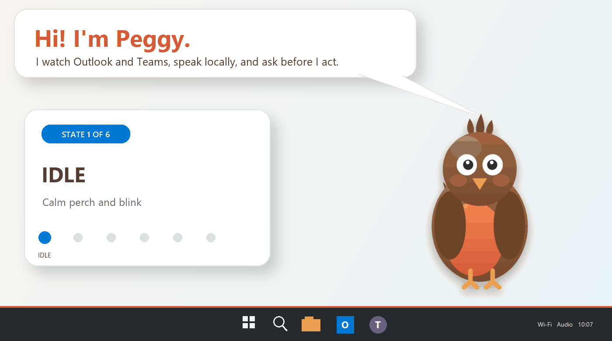
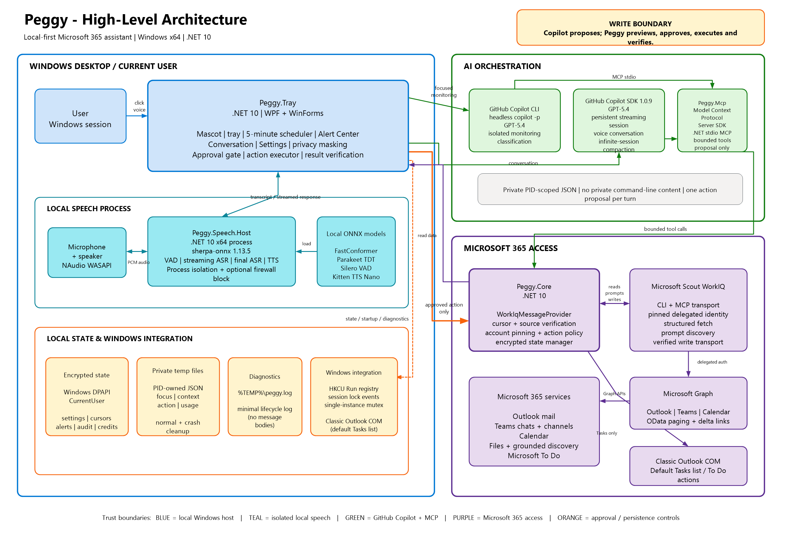

# Peggy

Peggy is a local-first Windows desktop assistant for Microsoft 365. She watches
Outlook and Microsoft Teams, uses GitHub Copilot to decide what deserves
attention, presents source-linked alerts, and can prepare or execute a bounded
set of work actions only after explicit approval.

Peggy appears as an animated desktop bird with a tray menu, alert center, and
optional English voice conversation. Raw microphone audio and speech models
remain in a separate local process.

> **Current platform:** Windows x64, .NET 10, standalone Microsoft WorkIQ, and the
> GitHub Copilot CLI.



## Get started

Peggy v0.1.13 uses one **Peggy setup** window for prerequisites, installation,
account connection, and optional voice.

**Beta preview: [v0.1.14-beta.4](https://github.com/didiergbenou-ms/peggy/releases/tag/v0.1.14-beta.4).**
This beta makes Teams classification recipient-aware: requests clearly directed
only to someone else are excluded, while direct, explicit and team-wide requests
can still qualify. It retains beta.3's reply/like suppression without a second LLM
call, verified upgrade relaunch and release-workflow recovery. To try it, download
`peggy-v0.1.14-beta.4-win-x64-setup.exe` from the beta release page.
The latest stable release and the installation examples below remain v0.1.13.

1. **Check access and prerequisites.** You need Windows x64, GitHub Copilot
   access, and a Microsoft 365 work account with a Work IQ usage-based billing
   plan and tenant administrator consent. The installer checks PowerShell 7,
   Node.js 18 or later with npm, and GitHub Copilot CLI 1.0.81 or later. Release
   packages are self-contained: no separate .NET SDK or runtime is needed.
2. **Download and install Peggy.** Open the
   [latest release](https://github.com/didiergbenou-ms/peggy/releases/latest)
   with a GitHub account that can access this private repository. Download
   `peggy-v0.1.13-win-x64-setup.exe` (or the corresponding filename for your
   chosen release). For stable v0.1.13, quit Peggy first; beta.2 can close it safely
   when you choose **Install / update**. Run setup normally from your desktop,
   not as administrator. Its prerequisite checklist offers explicit
   install/update actions. Packages are **not Authenticode-signed**; Windows
   SmartScreen may warn about an unknown publisher. Follow your organization's
   policy rather than bypassing a managed block.
3. **[Complete Peggy setup](#first-run-setup).** Continue in the same window after
   installation completes. Check GitHub Copilot access, install standalone
   WorkIQ if needed,
   review its EULA, and sign in with the Microsoft 365 account Peggy should use.
   Confirm **Account verified** and **Mail access ready**. Voice models are optional.
   Choose **Finish and launch** to start Peggy.
4. **Choose when and what to check.** Fresh installs monitor **Inbox only** and
   **Chats only**, every **5 minutes**, during **07:00–19:00 local time**.
   In **Settings → Monitoring behavior → Check Outlook and Teams every
   (minutes)**, choose **1–60 whole minutes** and select **Save**. The interval
   applies to both enabled sources without restarting; shorter intervals make
   more WorkIQ requests. Wake/sleep hours are separate settings.
5. **Try a check.** Right-click Peggy or the tray icon and select **Check now**;
   open **Open alerts** to review results. Source links open the relevant
   Outlook or Teams item. Monitoring does not write to Microsoft 365.

Need another installation method or more detail? See
[Installation and setup](#installation-and-setup),
[Prerequisites](#prerequisites), and [Using Peggy](#using-peggy).
Developers can skip to [Build from source and publish](#build-from-source-and-publish).

## Contents

- [Get started](#get-started)
- [Highlights](#highlights)
- [Architecture](#architecture)
- [Monitoring behavior](#monitoring-behavior)
- [Privacy](#privacy)
- [Safety model](#safety-model)
- [Prerequisites](#prerequisites)
- [Installation and setup](#installation-and-setup)
- [Using Peggy](#using-peggy)
- [Settings](#settings)
- [Supported actions](#supported-actions)
- [Local speech](#local-speech)
- [Build from source and publish](#build-from-source-and-publish)
- [Testing](#testing)
- [Configuration reference](#configuration-reference)
- [MCP tools](#mcp-tools)
- [Local files and state](#local-files-and-state)
- [Project layout](#project-layout)
- [Running with sample data](#running-with-sample-data)
- [Troubleshooting](#troubleshooting)
- [Current limitations](#current-limitations)
- [Third-party software](#third-party-software)

## Highlights

- Monitors unread Outlook mail and Teams chat activity at a configurable interval
  (five minutes by default).
- Starts each process with a fresh five-minute lookback instead of replaying a
  large downtime backlog.
- Uses strict, source-grounded Copilot classification to create Critical,
  Attention, and Awareness alerts.
- Opens alerts in the exact Outlook or Teams source when a verified link is
  available.
- Offers five Outlook modes and five Teams modes, from Inbox/chats only to
  selected folders/channels, broader discovery, or Off, with durable selections.
- Provides a warmed, persistent Copilot conversation with streamed responses.
- Runs English speech recognition and synthesis locally with sherpa-onnx.
- Requires an exact action preview and explicit approval before every write.
- Requires a second typed confirmation for destructive actions.
- Pins one Microsoft 365 identity and rejects a different authenticated account.
- Stores state with Windows DPAPI for the current user.
- Tracks local AI-credit usage and keeps a 30-day local action audit.
- Diagnoses interrupted monitoring with deterministic account, source, model,
  and read-only retrieval replay checks.

## Architecture

The diagram intentionally shows only Peggy's main runtime boundaries and
service relationships. Implementation details remain in the sections below.



[Edit the architecture diagram in Excalidraw](docs/diagrams/peggy-architecture.excalidraw).

### Components

| Component | Responsibility |
| --- | --- |
| `Peggy.Tray` | WPF mascot, tray menu, alert center, conversation UI, monitoring scheduler, privacy masking, and approval flow |
| `Peggy.Core` | Microsoft 365 provider, encrypted state, monitoring cursors, action policy, source verification, and shared models |
| `Peggy.Mcp` | Bounded MCP read tools and the proposal-only `prepare_action` tool |
| `Peggy.Speech.Host` | Isolated x64 process for microphone capture, VAD, speech recognition, and text-to-speech |
| `Peggy.Core.Tests` | Executable smoke and regression suite covering core, desktop, assistant, action, and speech behavior |

### Copilot execution modes

Peggy uses two Copilot paths:

1. **Monitoring:** each focused batch receives a new `copilot -p` session, so
   classifications never resume prior monitoring history. Copilot sees short
   batch-local aliases instead of Outlook or Teams identifiers. Peggy validates
   alias ownership and maps accepted decisions back to exact local identifiers
   and verified source links.
2. **Conversation:** one warmed official .NET Copilot SDK session streams text
   deltas and uses the same bounded Peggy MCP tools.

Temporary private files include process ownership in their names. Normal
cleanup removes them after each operation, and startup cleanup removes files
whose owning process has exited.

## Monitoring behavior

### Schedule and polling

- Automatic monitoring runs every five minutes by default. **Settings →
  Monitoring behavior → Check Outlook and Teams every (minutes)** accepts
  1–60 whole minutes, shared by both enabled sources and applied immediately
  on Save without restarting. Shorter intervals make more WorkIQ requests.
- The default awake window is **07:00-19:00 local time**.
- Outside that window Peggy sleeps and automatic checks pause.
- **Check now** and **Talk to Peggy** remain available while sleeping.
- Waking or restarting establishes a new five-minute lookback, independent of
  the configured polling interval. Older profiles without an interval use
  the five-minute default.
- Normal monitoring uses persisted batches of at most 20 items. Consecutive
  failures reduce retries to 10, 5, and then 1 item so one problematic item can
  be isolated without silently advancing the source cursor.
- Read-only WorkIQ calls retry bounded transient `429`, `500`, `502`, `503`,
  and `504` responses; write operations are never replayed automatically.
- Three consecutive monitoring failures mark monitoring as interrupted and
  surface remediation in the Alert Center.
- Each classifier receives only `get_turn_context` and the scoped
  `list_unread` tool. Message fields are treated as untrusted data.

### Outlook

Outlook has five monitoring modes:

| Mode | Included sources |
| --- | --- |
| **Inbox only** (fresh-install default) | Inbox itself, without subfolders |
| **Inbox + selected folders** | Inbox plus selected subfolder trees |
| **Selected folders only** | Selected subfolder trees, excluding Inbox itself |
| **Inbox + all subfolders** | Inbox and all current and future descendants |
| **Off** | No Outlook monitoring |

Folder selection is limited to the Inbox hierarchy, not other top-level
mailbox folders. Selecting a folder includes its descendants. Existing saved
selections and effective scope are migrated without change during upgrades.

Outlook cursors use message activity boundaries and delta links where
available. Source references are verified before they are attached to alerts.
Regional HTTPS links under `*.mail.microsoft.com` are rewritten to the
equivalent `outlook.office.com` URL to avoid regional endpoint authorization
failures. When Peggy opens an Outlook link, it extracts the validated Graph
item ID and builds one modern `/mail/{account}/deeplink/read/{item}` path for
the pinned mailbox. Legacy OWA query paths, nested schemes, and duplicated
URLs are never launched.

### Teams chats

The **All Teams activity** scope uses WorkIQ's structured `/search/query`
operation for newly sent messages in a bounded UTC window. Each search hit carries its message identity,
timestamp, sender, and exact Teams source link, so Peggy does not depend on a
natural-language answer to associate content with its source. Search windows
overlap by ten minutes. Peggy enriches search hits through bounded, batched
WorkIQ entity reads when possible, including resolving channel reply roots.
Stable message identities prevent duplicate classification across search and
watchlist delta scans while allowing recently indexed messages to be recovered.
Large result sets continue from a persisted search offset instead of restarting
or silently dropping later pages.

WorkIQ exposes `/search/query` through its generic `do_action` POST transport,
but the operation is read-only. Peggy does not send or modify a Teams item
during monitoring.

Teams has five monitoring modes:

| Mode | Included sources |
| --- | --- |
| **Chats only** (fresh-install default) | Direct and group chats |
| **Chats + selected channels** | Chats plus selected channels or entire teams |
| **Selected channels only** | Selected channels or entire teams, without chats |
| **All Teams activity** | Broad discovery plus full monitoring of selected channels |
| **Off** | No Teams monitoring |

The chat-specific modes use recent bounded direct and group chat windows and
exclude meeting chats. Only **All Teams activity** runs broad structured search.
Saved selections remain available when changing modes but do not broaden the
current mode. Existing installations retain their effective monitoring scope.

Explicit unread views remain bounded structured WorkIQ reads and compare chat
activity with the caller's `lastMessageReadDateTime`. Teams links must identify
a specific `/l/message/` item rather than only a generic chat.

### Teams channels

- Broad Teams discovery uses structured WorkIQ search for the current monitoring
  window and discovers messages by sent time only in **All Teams activity**.
- Search results must contain a compatible exact Teams message link before
  Peggy creates an alert.
- Selected channels use structured Graph delta scans and include edits to older
  messages. **Selected channels only** bypasses broad search entirely.
- Selecting an entire team includes all accessible current and future channels.
  Individual channels can be excluded, and the team catalog refreshes every
  30 minutes.
- Known channel participation is retained across monitoring-window rebases.

### Alert lifecycle

**Recipient relevance (beta.4):** Teams messages include conversation type,
structured mention names, whether each mention targets the signed-in user, and
whether mention metadata is complete. The existing classification call decides
who is expected to act before assigning priority. Requests clearly directed only
to another person are excluded; chat membership, a watched channel or a customer
deadline alone does not make that work yours. Direct messages, explicit
assignments and genuine team-wide requests can still qualify without an
@mention. Messages are assessed individually, so an unrelated request does not
silence a later message addressed to you in the same conversation.

This uses no additional LLM call and does not alter monitoring scopes or delete
existing alerts. The reply/like acknowledgment check still runs afterward for
each relevant message, sharing one fresh thread snapshot within the batch.
Remaining requests are combined into one card per conversation without
reintroducing messages already acknowledged or addressed only to others.

Bubble actions, daily clearing, and refresh before notifying described below
are new in **v0.1.14-beta.1**.

Each alert records its source, reason, tier, activity time, message IDs, and
material-change hash. Alerts can be:

- Resolved.
- Dismissed.
- Snoozed for one hour.
- Reclassified between Critical, Attention, and Awareness.
- Used as focused context for a Peggy conversation.

Feedback such as **Less like this** and **Always alert** is retained locally and
included in later classification runs.

**Settings > Monitoring behavior > Receive Awareness alerts** controls the
Awareness tier for both Outlook and Teams. It is on by default, including after
upgrading an existing profile. Turning it off and saving skips new Awareness
alerts and hides stored Awareness items from the active list, counts and Peggy's
active-alert context. Critical and Attention alerts remain enabled. Explicit tier
feedback is applied before this filter, so **Always alert** items promoted to
Attention are still received.

The Awareness preference and Teams refresh pagination are new in v0.1.14-beta.2.

This takes effect on Save without restarting or deleting history. Re-enabling
shows still-active stored Awareness items, but does not replay messages skipped
while off or generate catch-up pop-ups. Awareness remains non-interrupting.

At the start of each local calendar day, Peggy clears previous-day Critical,
Attention, and Awareness alerts from the active list, including snoozed alerts.
Newly detected alerts and new source activity today can still raise alerts,
including in a previously cleared conversation. This also runs while
monitoring is paused or Peggy is sleeping, and catches up on launch or Windows
resume. It does not wait for the next Outlook/Teams poll.

Daily clearing dismisses the local alert rather than marking the work resolved.
Dismissed records follow the existing local history retention; Outlook/Teams
messages, monitoring cursors, seen-message markers, feedback and settings are not
deleted or reset. A previous-day evaluation finishing after midnight cannot bring
its old notification back unless it contains new activity today. This reset does
not discard older messages that Peggy first discovers today.

Before adding a new alert or re-notifying a due snoozed alert, Peggy refreshes
the exact Outlook/Teams conversation through WorkIQ and applies a local
acknowledgment rule: a sent reply from the signed-in user after the triggering
message suppresses its notification. For Teams, that user's own thumbs-up/like
on the triggering message also counts. If an alert covers multiple messages,
each must be covered by a later sent reply or its own like; acknowledging one
does not hide a different unanswered request.

Even "OK" or "I will investigate" counts as a sent reply. Peggy does not judge
whether the work is finished, and a like is not approval of a JIT/access request.
Read status, drafts, other people's reactions and edits to an older sent message
do not count as a new reply. There is **no second Copilot/LLM evaluation** in this
check; initial alert classification still uses Copilot. WorkIQ reads may incur
their own service charges. This reply/like-only rule replaces beta.2's LLM
reassessment in v0.1.14-beta.3.

The check uses message identities, authors, original sent times and reactions,
not message-body interpretation. Failed or incomplete reads preserve the original
alert. Reads follow verified same-conversation continuation pages, bounded to ten
pages, 250 items and a 30-second source timeout within a 60-second batch budget.
Repeated, non-progressing or wrong-resource pages retain the alert. Logs record
`already-replied`, `acknowledged-by-like`, `not-acknowledged` or a technical failure
without message content. Refresh is a snapshot, not a guarantee against a later
reply. It does not continuously clear already-shown alerts or change messages,
polling cursors or settings.

New or reactivated Critical/Attention alerts appear in Peggy's bubble without
opening or focusing the Alert Center automatically. Click the bubble's body to
open and highlight its matching alert in Peggy, or use the close button to hide
only the bubble; closing it does not resolve or dismiss the alert. Escape also
closes a focused bubble. Ordinary greetings and status bubbles do not open alerts.
Privacy masking still applies when opening an alert this way. The Alert Center
remains available from the tray; existing startup and monitoring failure notices
remain separate.

## Privacy

Peggy is local-first, but not fully offline. Local speech, encrypted state, and
desktop interaction stay on the Windows device. GitHub Copilot and standalone
Microsoft WorkIQ connect to cloud services, so Peggy sends them only the
content needed for the requested monitoring or conversation task.

### Data flow at a glance

| Data | Where it is handled | Can it leave the device? |
| --- | --- | --- |
| Raw microphone audio | Isolated `peggy-speech-host.exe` process | No |
| Live partial speech text | Local conversation preview | No |
| Accepted final transcript | Peggy, then Copilot or WorkIQ | Yes, after the undo window or explicit review |
| Outlook, Teams, calendar, file, and task content | WorkIQ and focused Copilot context | Yes, when needed for monitoring, discovery, or conversation |
| Settings, cursors, alerts, feedback, credits, and audit | DPAPI-encrypted local state | No |
| Focus, context, action, and usage files | PID-owned temporary files under `%TEMP%` | The files stay local; selected contents can be sent through Copilot or WorkIQ |
| Diagnostic lifecycle events | `%TEMP%\peggy.log` unless overridden | No; message bodies are not logged |

### Voice privacy

- Microphone capture, voice activity detection, speech recognition, and
  text-to-speech run in the separate local speech process.
- Raw audio is never sent to GitHub Copilot, WorkIQ, or Microsoft 365.
- Live partial transcripts remain local and are never eligible for send.
- The accurate final transcript appears in an editable preview first.
- Ordinary requests have a visible one-second undo window.
- Editing the transcript or selecting **Cancel auto-send** pauses sending.
- Action approval transcripts always require explicit review.
- Ending the conversation or selecting **Unload voice models** terminates the
  speech process and releases native model memory.

### Cloud processing

- **GitHub Copilot** receives focused message context for alert classification,
  accepted conversation text, and the bounded context needed to answer.
- **Microsoft WorkIQ** accesses Microsoft 365 under the pinned delegated
  account for structured reads, grounded discovery, and approved actions.
- **Microsoft 365** remains the system of record for Outlook, Teams, Calendar,
  files, and To Do data.
- Peggy does not use a cloud relay, custom webhook, or background data export.
- Copilot cannot write directly to Microsoft 365.

Cloud processing remains subject to the policies, retention, and compliance
controls of the connected GitHub and Microsoft 365 services.

### Local storage and retention

- Persistent state is encrypted with Windows DPAPI using
  `DataProtectionScope.CurrentUser`.
- State is bound to the current Windows user and the pinned Microsoft 365
  account.
- Action audit entries are retained locally for 30 days.
- Temporary private files are deleted after normal operations.
- Temporary file names include the owning process ID. A later Peggy process
  removes files left by a crashed owner.
- Speech models are stored separately under
  `%LOCALAPPDATA%\Peggy\models` and contain no mailbox content.

To erase Peggy's persistent local state, quit Peggy and delete:

```text
%LOCALAPPDATA%\Peggy\state.dat
```

This removes settings, account pinning, cursors, alerts, feedback, credits, and
audit history. It does not remove the separately installed speech models.

### Privacy controls

| Control | Effect |
| --- | --- |
| **Pause monitoring** | Stops automatic Microsoft 365 checks |
| Monitoring schedule | Limits automatic checks to configured local hours |
| Disable local speech | Prevents voice conversations from loading |
| **Unload voice models** | Ends speech activity and releases model memory |
| Lock Windows | Ends voice activity, hides private UI, and masks alert content |
| **Reveal details** | Temporarily reveals masked alert content for one minute |
| **Quit Peggy** | Stops monitoring, Copilot sessions, and local speech |
| Speech-host firewall rule | Optionally blocks outbound network access for only the speech process |

## Safety model

### Account pinning

During account setup, Peggy asks which Microsoft 365 account to use. It completes
WorkIQ sign-in and consent, verifies the authenticated profile, then stores the
verified identity in encrypted state before structured reads, prompts, or
writes can begin.

The entered value may match either the mailbox address or user principal name.
Peggy resolves the canonical Outlook address after validation. A different
authenticated identity is rejected. Later reauthentication is available from
Settings and the tray menu.

### Approval boundary

Copilot cannot directly write to Microsoft 365. The MCP `prepare_action` tool
only validates and stages one proposal. The tray host:

1. Normalizes and validates the proposed fields.
2. Displays and speaks the exact operation.
3. Requests approval.
4. Executes the write through WorkIQ only after approval.
5. Reads the result back and verifies it.
6. Records the outcome in the encrypted local audit.

| Action class | Required approval |
| --- | --- |
| Non-destructive writes | Click approval or an immediate natural-language voice approval |
| Cancel calendar event | Exact typed confirmation |
| Delete Outlook message | Exact typed confirmation |
| Delete Microsoft To Do task | Exact typed confirmation |

Approvals are bound to the exact staged action ID. Interrupting a turn,
switching alerts, cancelling, or replacing a proposal clears stale approval
state.

### Source trust

Message bodies, prompt results, and quoted alert details are treated as data,
not instructions. Alert links must pass source-specific validation before
Peggy opens or persists them.

## Prerequisites

1. **Windows x64.**
2. **.NET 10 SDK** for development, or the .NET 10 Desktop Runtime only for a
   framework-dependent published build. GitHub Release packages are
   self-contained.
3. **GitHub Copilot CLI 1.0.81 or later** installed, authenticated, and
   available on `PATH`. Version 1.0.81 introduced the
   `--usage-output-file` support required by Peggy's monitoring classifier.
4. **Node.js 18 or later with npm** for standalone WorkIQ installation.
5. A **Work IQ usage-based billing plan** with the user assigned.
6. **Administrative consent** for the Work IQ application in the Microsoft
   Entra tenant.
7. **PowerShell 7** for the release installer prerequisites.
8. `curl.exe` and `tar.exe` only for the optional speech-model installer.
9. **Classic Outlook desktop** for Microsoft To Do task reads and actions.
10. A microphone and audio output device for voice features.

See the official
[Microsoft Work IQ CLI documentation](https://learn.microsoft.com/microsoft-365/copilot/extensibility/work-iq/cli)
for billing, tenant consent, support, and platform requirements.

Peggy resolves standalone WorkIQ in this order:

1. `PEGGY_WORKIQ_PATH`.
2. `workiq.exe` or the global npm wrapper on `PATH`.
3. `%APPDATA%\npm\node_modules\@microsoft\workiq\bin\win-x64\workiq.exe`.

## Installation and setup

### Install from a GitHub Release

#### One-window setup

Run `peggy-v0.1.13-win-x64-setup.exe` normally from your own Windows
desktop, not **Run as administrator**. Quit a running Peggy instance before
continuing; the setup window offers Retry instead of stopping Peggy for you.

The same Peggy window stays open through:

1. **Local requirements:** check PowerShell, Node.js/npm, and Copilot CLI. Missing
   tools have explicit install/repair actions; WinGet and vendor prompts remain visible.
2. **Install / update Peggy:** install the embedded MSI with progress in Peggy's
   window. Account setup is disabled until Windows Installer has finished.
3. **GitHub Copilot and Microsoft 365:** use the existing device-code, WorkIQ EULA,
   verified-account and mail-readiness steps. Eligible saved accounts are verified
   and reused rather than requiring a second first-run window.
4. **Optional English voice:** install or skip the models.
5. **Finish and launch:** save the verified account and start Peggy once.

Browser sign-in, Windows elevation, and vendor consent can still open their own
trusted prompts. A missing WinGet installation is reported with the requirement's
official download address. New vendor terms and interactive sign-in require
your action.

Cancellation during MSI work waits for Windows Installer to finish rollback;
vendor installer cancellation belongs to the vendor's visible prompt. Closing
after a successful installation does not uninstall Peggy: unfinished account setup
can be completed from Peggy later. A restart-required result stops before
onboarding and does not automatically reboot the machine.

Quiet/passive installs, maintenance, related-bundle upgrade removal, and
download-only `/layout` do not open account setup or launch Peggy. Existing
account-specific data, monitoring preferences and voice settings are preserved
during an upgrade. Direct MSI invocation remains an internal check-only path;
the unified installation window belongs to the setup EXE.

#### Stable release installation

The
[latest GitHub Release](https://github.com/didiergbenou-ms/peggy/releases/latest)
offers two current-user installation paths. All download filenames include
the release tag; the examples below use `v0.1.13` (substitute your chosen release):

1. **`peggy-v0.1.13-win-x64-setup.exe` (recommended)** opens the unified Peggy
   setup window
   for PowerShell 7, Node.js 18 with npm, and GitHub Copilot CLI 1.0.81 or later
   before installing the embedded MSI. Each requirement shows its status,
   version and technical details, with in-window progress, **Retry** and explicit WinGet
   **Install/Update/Repair** actions. Vendor consent and elevation remain
   visible; dependencies are never installed silently. If WinGet is unavailable,
   use the shown official download address or
   `peggy-v0.1.13-install.ps1 -InstallPrerequisites`.
2. **`peggy-v0.1.13-install.ps1`** retains the existing checksum-verified ZIP path, optional
   WinGet prerequisite installation, and optional speech-model download.

The setup EXE is the downloadable Windows installer. The standalone MSI and its
checksum are no longer published; the same validated MSI remains embedded in the
EXE, including the existing upgrade fix.

The setup EXE installs x64 Peggy per user at
`%LOCALAPPDATA%\Programs\Peggy`, registers it in Installed Apps, and creates the
Peggy Start menu shortcut. WorkIQ installation, EULA acceptance, and Microsoft
365 sign-in remain explicit actions after the MSI finishes, in the same window.
The setup EXE does not automatically download speech models; select
**Install voice models** during setup or in Settings if voice is wanted.

Release packages are checksum-verified but **not Authenticode-signed**.
SmartScreen may show an unknown-publisher warning; this release does not remove
that warning.

After successful full-UI installation or upgrade and verified account setup,
**Finish and launch** starts Peggy in the signed-in user's desktop session.
Quiet/passive installs, maintenance, uninstalls and administrative extraction
do not launch Peggy. Unattended
setup checks prerequisites but never installs them; use the interactive
setup executable for guided prerequisite installation.

**Beta.3 upgrade handoff:** a detected older-version upgrade in full UI
automatically completes and reopens Peggy once its existing saved account is
verified as the same principal, the current WorkIQ EULA version and required
mail access are checked, and setup is saved successfully. The setup window
explains this before installation and displays progress during handoff. Fresh
installs, missing or changed saved identities, cancellation, failures and
restart-required installs still require deliberate completion; closing setup
does not launch Peggy.

Process-start errors and exits during the first 1.5 seconds leave setup open
with **Retry launch** and detailed diagnostics. Retrying launch reuses a process
already started and does not repeat committed setup saves. This short observation
detects immediate exits; it is not a guarantee of full UI or service readiness.

To upgrade, run the newer installer without uninstalling Peggy first. The
installer replaces the previous application payload inside the Windows Installer
rollback transaction, including files from older builds that reused a file
version. Settings, monitoring selections, saved account preference, and downloaded
speech models are preserved. Re-running the same release is maintenance, not an
upgrade, and does not automatically launch Peggy.

**Beta.2 upgrade behavior:** opening setup and checking requirements leave Peggy
running. Choosing **Install / update Peggy** requests shutdown of the verified
current-user installation, waits for its exit and unlocked files, then installs.
Versions supporting the new shutdown endpoint finish current work, stop voice and
save state before exiting. Already-shipped v0.1.13 and v0.1.14-beta.1 instead use
Windows Restart Manager without force termination; those versions cannot confirm
a final state save. Unverified, unsupported or unresponsive processes require
manual Quit and Retry/Cancel. No unrelated Node or Copilot processes are targeted.
Quiet/passive operations and maintenance do not automatically close Peggy.

Only one same-user setup instance can own preparation and installation. Setup
disables Burn's separate implicit uninstall-on-exit cleanup, which runs after the
setup UI process and its lock have exited. Explicit uninstall and real install
transactions still retain their normal execution and rollback handling. Automatic
purging of eligible orphaned bundle registrations is intentionally skipped instead
of risking another instance's installation. These protections do not repair
earlier lost local data.

**Rollback limitation:** a non-elevated Windows Installer rollback can restore
the previous files without restoring the previous product's fully installed
registration. Do not treat file restoration alone as a successful rollback;
retain the installer logs and seek support if an upgrade fails.

Interactive installation:

```powershell
.\peggy-v0.1.13-win-x64-setup.exe
```

Unattended installation:

```powershell
.\peggy-v0.1.13-win-x64-setup.exe /quiet /norestart
```

For the script path, download `peggy-v0.1.13-install.ps1`, then run:

```powershell
powershell.exe -ExecutionPolicy Bypass -File .\peggy-v0.1.13-install.ps1 `
    -InstallPrerequisites
```

The installer:

- Downloads the latest self-contained Windows x64 package.
- Verifies its SHA-256 checksum before extraction.
- Downloads and verifies about 803 MiB of local English voice models.
- Installs for the current user under `%LOCALAPPDATA%\Programs\Peggy`.
- Creates a Start menu shortcut and launches Peggy.
- Can install PowerShell 7, Node.js LTS, and GitHub Copilot CLI through WinGet
  when `-InstallPrerequisites` is present.
- Requires GitHub Copilot CLI 1.0.81 or later. If WinGet provides an older
  version, the installer runs `copilot update stable` before installing Peggy.
- Preserves encrypted Peggy state during upgrades because state lives outside
  the installation directory.

Add `-SkipSpeechModels` to install without the local voice models, or
`-NoLaunch` to install without starting Peggy. The former
`-InstallSpeechModels` switch remains accepted for compatibility. Use
`-Version <release-tag>` to install a specific published release (for example,
`-Version v0.1.13`). The script still defaults to the latest stable release,
regardless of its own filename. It selects the ZIP and checksum together from
the resolved release, including authenticated GitHub CLI retries. Older tags
with the legacy `peggy-win-x64.zip` / `peggy-win-x64.sha256` pair remain supported;
incomplete versioned pairs fail rather than mixing filenames or release tags.

This repository is currently private. Authenticate GitHub CLI with repository
access (`gh auth login`) or set `GH_TOKEN` before running the installer. If the
repository becomes public, neither is required. The installer does not persist
the token.

The package and checksum can also be downloaded manually:

```powershell
.\peggy-v0.1.13-install.ps1 `
    -PackagePath .\peggy-v0.1.13-win-x64.zip `
    -ChecksumPath .\peggy-v0.1.13-win-x64.sha256
```

When `-ChecksumPath` is omitted, the script uses the ZIP's basename with a
`.sha256` extension. Inside installed/extracted packages, the canonical names
remain `peggy-tray.exe`, `install.ps1`, and `uninstall.ps1`; installation
directories are unchanged.

### Uninstall

Use **Installed Apps**, or uninstall a setup-EXE installation unattended:

```powershell
.\peggy-v0.1.13-win-x64-setup.exe /uninstall /quiet /norestart
```

For an existing direct-MSI installation, use **Installed Apps**.

Normal MSI/bootstrapper uninstall removes application files, the Start menu
shortcut, ARP registration, the Peggy startup Run entry only when it points to
this canonical installation, `%LOCALAPPDATA%\Peggy` (including encrypted state
and speech models), and the current-user `PEGGY_WORKIQ_ACCOUNT` preference.
Major upgrades preserve that data. Uninstall never removes shared PowerShell,
Node.js, GitHub Copilot CLI, or WorkIQ installations.

For the script-installed path, exit Peggy and run the uninstaller from its
installation directory:

```powershell
powershell.exe -ExecutionPolicy Bypass -File `
    "$env:LOCALAPPDATA\Programs\Peggy\uninstall.ps1"
```

The uninstaller removes Peggy's application files, Start menu shortcut, and
optional startup entry. It preserves encrypted settings and local speech models
so they remain available after a reinstall. To remove those files and Peggy's
temporary runtime data and synchronized account preference too, add
`-PurgeData`:

```powershell
powershell.exe -ExecutionPolicy Bypass -File `
    "$env:LOCALAPPDATA\Programs\Peggy\uninstall.ps1" -PurgeData
```

Use `-WhatIf` to preview the cleanup. Shared prerequisites such as PowerShell 7,
Node.js, GitHub Copilot CLI, and WorkIQ are not removed. An uninstaller run from
a custom installation directory detects that directory automatically; a
standalone release copy (`peggy-v0.1.13-uninstall.ps1`) can target it with
`-InstallDirectory`.

### First-run setup

The unified setup EXE hosts these steps after installation in the same window.
For ZIP/script installations, or if account setup was left incomplete, Peggy
opens **Peggy setup** when launched:

1. Review local prerequisite readiness and install standalone WorkIQ if needed.
   Check GitHub Copilot access, or use **Sign in to GitHub Copilot** when authentication
   is needed. Peggy uses the official CLI's **device-code flow**: select
   **Copy code** and **Open GitHub**, authorize the one-time code in GitHub,
   then wait for the model-access check. The CLI manages credentials; Peggy
   never asks for a GitHub password or stores the sign-in code in its state.
   Network sign-in and permission consent require explicit actions.
2. Enter the work email address Peggy should use. Only a previously verified
   identity is prefilled; unverified environment hints are not used.
3. Review and accept the WorkIQ EULA. Peggy records the exact accepted WorkIQ
   build in its encrypted state.
4. Optionally select **Install voice models** to download and SHA-256 verify
   about 803 MiB of local English speech models.
5. Select **Sign in with Microsoft** and complete any Microsoft sign-in or
   permission-consent prompt WorkIQ opens. Peggy never asks for a password.
6. Under **Microsoft 365 connection**, review **Account verified** and
   **Mail access ready**. Peggy checks the authenticated profile and Inbox
   access separately without enumerating Inbox subfolders.
7. Review the connected-account card and complete setup. **Change account**
   returns to the editable email field. Mismatched identities are rejected;
   cancellation preserves Peggy's previously pinned connection.

If the tenant has not granted the required WorkIQ permissions, an administrator
must complete tenant consent before verification can succeed.

Each setup step shows its actual progress independently: a spinner while work
is running, a distinct waiting-for-user state during authorization, a green
check after success, and a warning with retry guidance on failure. Completion,
cancellation and window closure stop the animation. Windows reduced-animation
preferences retain the status text and static icon without continuous movement.
GitHub codes are cleared when sign-in ends or is cancelled; expired or rejected
authorization requires a new attempt. If the installed CLI does not expose
`login --device-code`, update it rather than silently changing sign-in flows.
Microsoft 365 sign-in remains WorkIQ-managed and uses the verified work email.

Voice setup can be skipped. Open **Settings → Local voice (English only)** and
select **Install voice models** later; the same verified downloader is used.
Fresh installs monitor **Inbox only** and **Chats only**. Additional Inbox
folders and Teams channels are opt-in through Settings. Optional voice does
not block setup completion.

Use **Microsoft 365 account** from the tray or **Change or reconnect** in
Settings to refresh authentication or enter another account. After Peggy
verifies a different identity, it clears local alerts, monitoring cursors,
account-specific Outlook folders and Teams selections, Copilot conversation
context, credit history, and action audit for the previous account. General
schedule, model, startup, and speech preferences are preserved.
The account field remains editable even when `PEGGY_WORKIQ_ACCOUNT` is already
set. After verification, Peggy synchronizes that current-user preference to the
selected account; encrypted verified identity remains authoritative.

If WorkIQ loses its local `I-accept-EULA` setting, Peggy restores it
automatically only when the installed WorkIQ build exactly matches the build
whose EULA was accepted. A WorkIQ update requires the user to review and accept
the current EULA again through **Change or reconnect**.

## Using Peggy

Peggy runs as a single-instance tray application. Right-clicking either the
tray icon or the desktop mascot opens the same menu. Double-clicking the tray
icon opens the Alert Center.

The Alerts header shows the semantic release version beside Peggy. **Help →
About** shows the same version (for example, `v0.1.13`) and lets you copy it.

### Tray menu

| Command | Behavior |
| --- | --- |
| **Open alerts** | Opens active Critical, Attention, and Awareness alerts |
| **Talk to Peggy** | Starts a local voice conversation |
| **Unload voice models** | Ends voice activity and releases native model memory |
| **Check now** | Runs a monitoring check even while scheduled sleep is active |
| **Pause monitoring** | Toggles manual monitoring pause |
| **AI credits today** | Shows recent local Copilot credit entries |
| **Microsoft 365 account** | Reconnects the current account or switches to another verified identity |
| **Settings** | Opens model, source, voice, schedule, startup, and watchlist settings |
| **Show or hide Peggy** | Toggles the desktop mascot |
| **Test animations** | Plays individual or all mascot states |
| **Help → Troubleshooting** | Runs read-only account, Teams, Copilot, and monitoring checks on demand and can create a diagnostic ZIP |
| **Help → About** | Shows Peggy's semantic release version with a copy action |
| **Quit Peggy** | Stops monitoring, closes Copilot, unloads speech, and exits |

### Alert Center

The Alert Center shows:

- The alert tier and source.
- A concise summary.
- Why Peggy flagged the item.
- The verified **Open in Outlook** or **Open in Teams** action.
- Resolve, dismiss, dismiss-all, snooze, feedback, tier correction, context,
  and conversation controls.

When privacy masking is active, details remain hidden until
**Reveal details** is explicitly confirmed. A reveal expires after one minute.
When monitoring is interrupted, **Troubleshoot** opens the captured failure
details and targeted checks beside **Retry now**.

### Voice conversation

1. Select **Talk to Peggy**, or start a conversation from an alert.
2. Peggy loads the local models and listens.
3. Live partial text appears locally.
4. The final transcript appears in an editable **I heard...** card.
5. Ordinary requests auto-send after a visible one-second undo window.
6. Editing the text or selecting **Cancel auto-send** pauses automatic send.
7. Approval transcripts never auto-send; they require explicit review.

Pressing the microphone while Peggy is thinking or speaking interrupts the
current turn and returns to listening. Ending a conversation unloads every
speech model.

## Settings

Settings are persisted atomically with the rest of Peggy's encrypted state.
Runtime services are staged before activation so a failed configuration does
not leave a partially applied identity, model, or source scope.

| Setting | Notes |
| --- | --- |
| Microsoft 365 connection | Shows the current account and supports reconnection or verified account switching |
| Pinned Copilot model | Loaded live from the authenticated GitHub Copilot CLI; **Refresh** uses a new catalog connection so newly available models appear without restarting Peggy; changing it starts a fresh Copilot session |
| Reasoning effort | Shows only the effort levels supported by the selected model; **Model default** lets Copilot choose |
| Context tier | Offers **Default** for every model and **Long context** only when the live catalog reports support |
| Outlook monitoring scope | Inbox only, Inbox + selected folders, Selected folders only, Inbox + all subfolders, or Off |
| Outlook folder picker | Shown for selected-folder modes; includes descendants and preserves unavailable saved selections |
| Enable local speech | Enables or disables the isolated English speech host |
| Speech model directory | Defaults to `%LOCALAPPDATA%\Peggy\models` |
| Install voice models | Downloads or repairs the SHA-256-verified English model bundle; about 803 MiB |
| Voice | Bella, Luna, Rosie, or Kiki |
| CPU threads | 1, 2, 4, or 8 |
| Microphone gain | 4x, 8x, 12x, or 16x |
| Monitoring schedule | Local 24-hour wake and sleep times |
| Check Outlook and Teams every (minutes) | 1–60 whole minutes, default 5; applies to both enabled sources on Save without restarting and is retained across restarts and account changes |
| Receive Awareness alerts | On by default; turn off to skip new Awareness alerts and hide existing ones without changing Critical/Attention alerts or deleting history |
| Start at Windows sign-in | Manages the current user's `Run` registry entry |
| Pause monitoring | Persists a manual pause independently of scheduled sleep |
| Teams monitoring scope | Chats only, Chats + selected channels, Selected channels only, All Teams activity, or Off |
| Teams source picker | Shown where channel selection applies; children are loaded only when expanded |

Source catalogs use account-specific in-memory caches across Settings windows.
Cached metadata appears immediately and stale lists refresh in the background.
**Refresh** requests current metadata; **Retry** recovers failures without
reopening Settings. Refresh does not erase selections, and unavailable saved
sources remain visible. Cached entries are not used as proof of live access.
There is no separate "Selected only" display filter.

Selected sources are always listed at the top of Settings and can be removed
without loading their team. Selecting an individual channel enables full
structured delta monitoring for it. Selecting an entire team includes all
accessible current and future channels; clearing one channel creates a durable
exclusion. A partially selected team is shown with an indeterminate checkbox.
Changing Teams scope resets only Teams progress, not Outlook progress. Activity
accumulated while Teams monitoring is Off is not replayed when it is enabled.

## Supported actions

Peggy can prepare these bounded actions:

| Area | Actions |
| --- | --- |
| Outlook | Mark a message read, create an email draft, send email, create a reply draft, send a reply, delete a message |
| Teams | Send a chat message or channel-thread reply |
| Calendar | Create an event, update an event, cancel an event |
| Microsoft To Do | Create, update, complete, or delete a task in the default `Tasks` list |

Limits enforced before approval include:

- At most 50 normalized recipients.
- Subject length up to 300 characters.
- Body length up to 10,000 characters.
- Valid event start/end ordering.
- ISO 8601 UTC timestamps for MCP calendar proposals.
- `YYYY-MM-DD` task due dates.
- No explicit recipient override for Outlook replies.
- One action proposal per Copilot turn.

## Local speech

Peggy never falls back to `System.Speech`, Windows Speech Recognizer, or an
installed Windows voice.

| Model | Role |
| --- | --- |
| NeMo streaming FastConformer CTC | Low-latency partial transcription |
| NeMo Parakeet TDT | Accurate final transcription |
| Silero VAD v5 | Voice activity detection and endpointing |
| Kitten TTS Nano | Local real-time English text-to-speech |
| NAudio WASAPI | Windows microphone and playback transport |

The speech host:

- Runs as a separate x64 process.
- Uses 450 ms endpointing.
- Receives model, thread, voice, speed, and gain settings through its process
  environment.
- Stays warm during a conversation.
- Is terminated when the conversation ends or models are unloaded.
- Has no application network features.

### Reinstalling incomplete models

The installer refuses to treat a partial model directory as complete. Use
**Settings → Local voice (English only) → Install voice models** to repair it.
From a source checkout, you can also run:

```powershell
.\scripts\Install-SpeechModels.ps1 -Force
```

To install in another directory:

```powershell
.\scripts\Install-SpeechModels.ps1 `
    -Destination "D:\Peggy\models"
```

Then select that directory in Settings or set `PEGGY_SPEECH_MODELS`.

## Build from source and publish

These instructions require a source checkout and the **.NET 10 SDK**. To use
Peggy without building it, follow [Get started](#get-started) instead.

Exit a running Peggy instance before rebuilding so loaded assemblies are not
locked.

### Build and run

Open PowerShell in the repository root. Peggy can install standalone WorkIQ
from its first-run window, or you can install it yourself:

```powershell
npm install -g @microsoft/workiq
workiq version
```

For optional local voice, install the models:

```powershell
.\scripts\Install-SpeechModels.ps1
```

The installer downloads about 803 MiB of pinned official sherpa-onnx assets,
verifies every SHA-256 digest, and installs them under
`%LOCALAPPDATA%\Peggy\models`. Source builds can run without the models by
disabling local speech in Settings. The release PowerShell installer downloads
them by default (`-SkipSpeechModels` opts out); the MSI/bootstrapper does not.

Build and launch:

```powershell
dotnet restore .\src\Peggy.Tray\Peggy.Tray.csproj
dotnet run --project .\src\Peggy.Tray\Peggy.Tray.csproj -c Release
```

The tray project automatically builds and packages the MCP server and speech
host beside the tray executable. Continue with [First-run setup](#first-run-setup).

### Optional speech-host firewall rule

From an elevated PowerShell window in the source checkout:

```powershell
.\scripts\Protect-SpeechHost.ps1
```

The script finds the newest standard, RID-specific, or publish Release host and
replaces the named outbound-block rule. If Peggy is installed elsewhere:

```powershell
.\scripts\Protect-SpeechHost.ps1 `
    -HostPath "C:\Apps\Peggy\Peggy.Speech.Host\peggy-speech-host.exe"
```

Rerun the script if the executable moves.

### Development build

```powershell
dotnet build .\src\Peggy.Tray\Peggy.Tray.csproj -c Release
```

Output:

```text
src\Peggy.Tray\bin\Release\net10.0-windows\
```

### RID-specific x64 build

```powershell
dotnet build .\src\Peggy.Tray\Peggy.Tray.csproj `
    -c Release `
    -r win-x64
```

Output:

```text
src\Peggy.Tray\bin\Release\net10.0-windows\win-x64\
```

### Framework-dependent publish

```powershell
dotnet publish .\src\Peggy.Tray\Peggy.Tray.csproj `
    -c Release `
    --self-contained false
```

Output:

```text
src\Peggy.Tray\bin\Release\net10.0-windows\publish\
```

### RID-specific publish

```powershell
dotnet publish .\src\Peggy.Tray\Peggy.Tray.csproj `
    -c Release `
    -r win-x64 `
    --self-contained false
```

The publish directory contains:

```text
peggy-tray.exe
Peggy.Mcp\
  peggy-mcp.exe
Peggy.Speech.Host\
  peggy-speech-host.exe
```

Both helper projects are published automatically by the tray project's MSBuild
targets.

### GitHub Releases

Pushing a semantic version tag creates a GitHub Release:

```powershell
git tag v0.1.0
git push origin v0.1.0
```

The release workflow runs the regression suite, builds with pinned WiX Toolset
6.0.2 packages, performs MSI database and administrative-image validation, and
requires isolated in-place upgrade and rollback regressions before publishing
six versioned assets (shown for `v0.1.13`):

- `peggy-v0.1.13-win-x64.zip`, a self-contained package for Windows x64.
- `peggy-v0.1.13-win-x64.sha256`, the package checksum used by `install.ps1`.
- `peggy-v0.1.13-win-x64-setup.exe` and `peggy-v0.1.13-win-x64-setup.exe.sha256`, the WiX Burn
  prerequisite-checking bootstrapper and its checksum.
- `peggy-v0.1.13-install.ps1`, the current-user bootstrap installer.
- `peggy-v0.1.13-uninstall.ps1`, the current-user uninstaller.

The MSI and its checksum are still generated locally for validation and bundling,
but are excluded from published assets. The setup EXE embeds the validated MSI.
Standalone MSI downloads and their checksums have also been withdrawn from
historical releases. Their setup EXEs remain unchanged.

There are no unversioned release aliases. Prerelease suffixes are retained in
every asset name (for example, `peggy-v1.2.3-beta.2-win-x64.zip`). Checksum files
record the exact downloadable asset basename. Internal build/publish filenames
remain generic and are copied to the versioned release paths.

Build all Windows artifacts locally with:

```powershell
$version = '<semver>'
.\scripts\Build-WindowsRelease.ps1 -Version $version
.\scripts\Test-PeggyWindowsInstaller.ps1 -Version $version
```

MSI uses three numeric version fields. To keep upgrade ordering correct, Peggy
maps stable `major.minor.patch` to `major.minor.(patch*100+99)`. Prereleases use
ordered slots: `alpha.1` through `alpha.29`, `beta.1` through `beta.30`, and
`rc.1` through `rc.39`. Major and minor must be at most 255 and patch at most
654. The semantic release version remains in `version.txt`, assembly metadata,
release notes, and artifact context. Unsupported prerelease forms fail the
build rather than producing an unsafe upgrade.

Every Peggy release binary also receives a four-part `FileVersion` equal to
the mapped MSI version followed by `.0`. This applies to the tray, Core, MCP,
speech host, and installer helpers, including nested publish outputs.
For example, `v0.1.11-beta.1` uses MSI `0.1.1130` and file version
`0.1.1130.0`; beta.2 uses `0.1.1131.0`, and stable uses `0.1.1199.0`.
For `v0.1.13`, MSI uses `0.1.1399` and binaries use `0.1.1399.0`, above
beta.1's `0.1.1330.0`; the Alerts header and About dialog still display the
semantic version `v0.1.13`.
The `v0.1.14-beta.4` preview uses MSI `0.1.1433` and binary file version
`0.1.1433.0`, above beta.3's `0.1.1432.0` and stable v0.1.13; its user-facing
version retains `-beta.4`.
Semantic prerelease labels alone do not change .NET's default file version.

WiX ICE custom actions can be blocked by policy in non-elevated build
environments (the local validation attempt returned `WIX1105`), so the build
suppresses that unavailable pass.
`Test-PeggyWindowsInstaller.ps1` instead inspects the MSI database, verifies the
stable UpgradeCode and upgrade sequence, compares every File-table entry,
creates a disposable `msiexec /a` administrative image, hashes every extracted
payload file, and extracts the Burn container with the pinned WiX command.
It also checks the mapped file version in the published binaries, installer
helpers, and MSI File table.

`Test-PeggyWindowsUpgrade.ps1` performs real `msiexec /i` transactions using
isolated copies of the previous and candidate MSIs. It keeps their payload bytes,
upgrade ranges, and production action conditions, but namespaces product/component
identities, directories, registry entries, and shortcuts. Executable custom actions
become inert markers so the regression cannot launch Peggy or use real account
data. It checks exact installed hashes, product replacement, unchanged test
settings/model/account sentinels, same-version maintenance, and a forced-failure
rollback to the previous payload and registration. CI uses nine checksum-verified
pinned baselines: the setup EXEs from `v0.1.10`, `v0.1.11-beta.1`, `v0.1.11`,
`v0.1.12`, `v0.1.13-beta.1`, `v0.1.13`, `v0.1.14-beta.1`, `v0.1.14-beta.2`,
and `v0.1.14-beta.3`.
The pinned WiX extraction tool reads each checksum-verified EXE without running
it and supplies its embedded MSI. Every baseline must pass the strict upgrade
and rollback checks. Restart Manager, real application startup, and interactive authentication
are outside this isolated regression.
Restoring files without restoring the previous product's fully installed
registration is a failure, not a successful rollback; failure logs and fixture
recovery information are retained for diagnosis.

Historical-baseline extraction gets up to three sequential attempts, with short
backoff and a fresh output/intermediate directory each time. The exact EXE hash
is rechecked before each attempt and after success; no partial files are reused.
Verbose WiX output and native exit codes are retained, and incomplete attached
container warning `WIX8503` is treated as an error. A successful extraction must
still pass the unchanged MSI identity/version checks. Hash mismatches, invalid
MSI identity and actual upgrade/rollback failures are not retried by this wrapper.
The workflow retains extraction and isolated-installer diagnostics as private
Actions artifacts for fourteen days, even when a later extraction attempt
recovers. Persistent failures still stop release publication and report failure.

The setup bundle uses a self-contained .NET/WPF bootstrapper and the shared Peggy
setup view. Only the MSI is in the Burn package chain; the old separate prerequisite
and application-launch packages are not used. `Test-PeggyBootstrapperPayload.ps1`
checks the complete runtime/dependency payload, and installer validation compares
every embedded bootstrapper file with its published bytes.
`Test-PeggyUnifiedSetupLayout.ps1` runs the actual EXE in quiet download-only mode
and checks that Peggy's installed files and registration are unchanged. This is
not a substitute for testing real prerequisite installers or account consent on
a disposable new Windows machine.

The MSI relies on Windows Installer Restart Manager for files in use, so only
processes holding this installation's files are asked to stop. A checked,
current-user deferred custom action is used on a real uninstall (not a major
upgrade) to remove the startup Run value only when it resolves exactly to the
canonical Peggy executable. A paired rollback action restores that exact value
if MSI rolls the uninstall back. After `InstallFinalize` successfully commits a
true uninstall, a separate current-user action removes Peggy's user-data root
and synchronized account preference. The cleanup action does not run during
upgrades or failed uninstalls and does not remove shared prerequisites or
broader LocalAppData. Any post-commit cleanup error is recorded by Windows
Installer without reversing the already-completed application uninstall.

Release packages are currently checksum-verified but not Authenticode-signed.
Windows SmartScreen can therefore show an unknown-publisher warning. The
workflow has explicit signing boundaries: sign the MSI before building the
bundle, sign the Burn engine/bundle using WiX's detach/reattach procedure, and
only then generate checksums. No certificate or signing secret is assumed.

## Testing

The test project is an executable smoke suite rather than a test-runner package.
It covers:

- Encrypted state and retention.
- Monitoring cursors, pagination, and Teams edits.
- WorkIQ retries, identity pinning, and source verification.
- Approval policy and verified action execution.
- MCP focus and proposal boundaries.
- WPF alert, settings, conversation, privacy, and mascot behavior.
- Local speech protocol, cancellation, and unloading.
- Temporary private-file crash recovery.

Run the complete isolated suite:

```powershell
dotnet run --project .\src\Peggy.Core.Tests\Peggy.Core.Tests.csproj `
    -c Release
```

Successful output ends with:

```text
All Peggy Core smoke tests passed.
```

Run the pure PowerShell release-asset regression tests without building or
installing Peggy, contacting GitHub, or using credentials:

```powershell
.\scripts\Test-PeggyReleaseAssets.ps1
```

These cover stable/prerelease names, staged scripts, checksum basenames and
hashes, local checksum discovery, and matched legacy/versioned downloads.
The release workflow also runs them before building.

Optional live switches use the configured Microsoft 365 or Copilot account:

| Switch | Purpose |
| --- | --- |
| `--live` | Exercises live Microsoft 365 read surfaces |
| `--live-channels` | Exercises live Teams channel reads |
| `--live-unread` | Exercises live unread-message retrieval |
| `--live-monitoring` | Exercises bounded structured monitoring with exact source validation |
| `--live-outlook-link` | Fetches one private Outlook message, creates a real Peggy alert, and launches the production source URL when enabled |
| `--live-copilot` | Exercises a live Copilot conversation |

Example:

```powershell
dotnet run --project .\src\Peggy.Core.Tests\Peggy.Core.Tests.csproj `
    -c Release `
    -- --live-unread
```

The Outlook-link test takes the private message ID only from the environment,
so it is never committed:

```powershell
$env:PEGGY_LIVE_OUTLOOK_MESSAGE_ID = '<Graph message ID>'
$env:PEGGY_LIVE_OUTLOOK_LINK_OUTPUT = "$env:TEMP\peggy-outlook-link.txt"
$env:PEGGY_LIVE_OUTLOOK_BROWSER_RESULT = "$env:TEMP\peggy-outlook-browser.json"
dotnet run --project .\src\Peggy.Core.Tests\Peggy.Core.Tests.csproj `
    -c Release `
    -- --live-outlook-link
```

The test launches through Peggy's production Windows shell path, then waits
for browser automation to return the same per-run nonce, hashes of the
navigated URL and rendered subject, `unauthorizedFound`, and the observed
Outlook `GetItem` status codes. It does not pass from URL construction alone
or from a stale browser result.

The automated action suite uses a fake WorkIQ transport and does not perform
external writes.

## Configuration reference

### User-facing overrides

| Variable | Purpose | Default |
| --- | --- | --- |
| `PEGGY_WORKIQ_ACCOUNT` | Current-user account preference, synchronized after verified sign-in | Encrypted account selected during first-run sign-in |
| `PEGGY_WORKIQ_PATH` | Explicit `workiq.exe` or compatible wrapper path | Auto-detected |
| `PEGGY_MESSAGE_PROVIDER` | `workiq` or `mock` | `workiq` |
| `PEGGY_COPILOT_PATH` | Explicit `copilot.exe` path | `PATH`, then the current user's WinGet links |
| `PEGGY_COPILOT_MODEL` | Process-level Copilot model override | Saved setting, initially `gpt-5.4` |
| `PEGGY_STATE_PATH` | Alternate DPAPI-encrypted state path | `%LOCALAPPDATA%\Peggy\state.dat` |
| `PEGGY_OUTLOOK_SCOPE` | Authoritative Outlook mode for standalone providers | `InboxOnly` |
| `PEGGY_TEAMS_MODE` | Authoritative Teams mode for standalone providers | `ChatsOnly` |
| `PEGGY_SPEECH_MODELS` | Alternate local speech-model directory | `%LOCALAPPDATA%\Peggy\models` |
| `PEGGY_SPEECH_HOST_PATH` | Explicit packaged speech-host executable | Auto-detected |
| `PEGGY_LOG_PATH` | Diagnostic log path | `%TEMP%\peggy.log` |

### Source-scope overrides

The tray normally derives these values from Settings and passes them to its
child processes:

| Variable | Format |
| --- | --- |
| `PEGGY_OUTLOOK_FOLDERS` | Semicolon-separated Inbox-relative paths |
| `PEGGY_INCLUDE_ACTIVE_CASES_FOLDER` | `true` or `false`; forwarded to Peggy's scoped Copilot MCP processes |
| `PEGGY_TEAMS_WATCHLIST` | JSON array of team/channel watch objects |
| `PEGGY_TEAMS_TEAM_WATCHLIST` | JSON array of whole-team watch objects and channel exclusions |
| `PEGGY_TEAMS_SCOPE` | `AllActivity`, `SelectedTeamsAndChannels`, or `Off` |
| `PEGGY_TEAMS_MONITOR_CHATS` | `true` to include direct and group chats in selected-only mode |

### Internal bridge variables

`PEGGY_FOCUS_FILE`, `PEGGY_CONTEXT_FILE`, `PEGGY_ACTION_FILE`, and the
`PEGGY_SPEECH_*` runtime variables are managed by Peggy. They are not intended
as end-user configuration.

## MCP tools

| Tool | Purpose |
| --- | --- |
| `list_unread` | Lists bounded unread Outlook and Teams messages, newest first |
| `get_thread` | Retrieves bounded context for an opaque thread ID |
| `list_upcoming_events` | Lists up to 50 events over a 1-30 day window |
| `list_tasks` | Lists up to 50 tasks from the pinned account's default Tasks list |
| `ask_workiq` | Performs broad grounded discovery across Microsoft 365 |
| `get_turn_context` | Reads the private JSON context for the current turn |
| `prepare_action` | Validates and stages exactly one proposal; never executes it |

When monitoring provides a focused message batch, `list_unread` and
`get_thread` are constrained to that batch.

## Local files and state

| Location | Contents |
| --- | --- |
| `%LOCALAPPDATA%\Peggy\state.dat` | DPAPI-encrypted settings, cursors, alerts, feedback, seen IDs, credits, and audit |
| `%LOCALAPPDATA%\Peggy\models` | Verified local speech models and `speech-models.json` manifest |
| `%TEMP%\peggy.log` | Minimal diagnostic lifecycle log unless overridden |
| `%TEMP%\peggy-*.json` | Short-lived private Copilot/MCP scope and usage files |
| `HKCU\Software\Microsoft\Windows\CurrentVersion\Run` | Optional `Peggy` startup entry |

Audit entries older than 30 days and stale operational markers are pruned when
state is normalized.

## Project layout

```text
peggy\
  README.md
  THIRD-PARTY-NOTICES.txt
  scripts\
    Install-SpeechModels.ps1
    Protect-SpeechHost.ps1
  src\
    Peggy.Core\
    Peggy.Core.Tests\
    Peggy.Mcp\
    Peggy.Speech.Host\
    Peggy.Tray\
```

Key implementation files:

| File | Purpose |
| --- | --- |
| `src\Peggy.Core\WorkIqMessageProvider.cs` | Microsoft 365 reads, cursors, writes, and verification |
| `src\Peggy.Core\EncryptedStateStore.cs` | DPAPI persistence and retention |
| `src\Peggy.Core\WorkActionPolicy.cs` | Proposal validation and exact approval descriptions |
| `src\Peggy.Tray\App.xaml.cs` | Application lifecycle, monitoring, tray, settings, and alerts |
| `src\Peggy.Tray\ConversationController.cs` | Voice-turn and approval state machine |
| `src\Peggy.Tray\CopilotRunner.cs` | Isolated Copilot CLI monitoring operations |
| `src\Peggy.Tray\PersistentCopilotConversation.cs` | Persistent Copilot SDK conversation |
| `src\Peggy.Tray\LocalSpeechService.cs` | Speech-host lifecycle and protocol |
| `src\Peggy.Speech.Host\SpeechRuntime.cs` | sherpa-onnx model loading and audio pipeline |

## Running with sample data

Mock mode exercises the UI without Microsoft 365 reads:

```powershell
$env:PEGGY_MESSAGE_PROVIDER = "mock"
dotnet run --project .\src\Peggy.Tray\Peggy.Tray.csproj -c Release
```

Remove the process override to return to WorkIQ:

```powershell
Remove-Item Env:\PEGGY_MESSAGE_PROVIDER
```

## Troubleshooting

### Troubleshoot interrupted monitoring

Select **Troubleshoot** in the Alert Center failure banner. Peggy preserves the
original stage, operation, status, request ID, timestamp, and exception chain,
then runs four deterministic checks:

1. Microsoft 365 account and Inbox access.
2. Configured Teams source access.
3. Access to the configured GitHub Copilot model.
4. The exact monitoring retrieval path against a cloned failure-time cursor.

The replay is read-only and never advances Peggy's monitoring cursor. It also
does not ask Copilot to diagnose Copilot. The result recommends the relevant
sign-in, Copilot settings, retry, or diagnostic action. **Copy technical
details** copies the complete report; **Create diagnostic ZIP** runs the
packaged collector with deterministic WorkIQ probes, without invoking Copilot
or sending email.

### Investigate a previous setup failure

Unified setup writes to `%TEMP%\Peggy_<timestamp>.log`; its Windows Installer
transaction uses the neighboring `_000_PeggyMsi.log` (the numeric suffix can vary).
Keep these files before Windows temporary-file cleanup removes them.

Starting with v0.1.14-beta.2, detailed setup logging adds `PEGGY_SETUP` records with a per-process
session ID, PID, UTC timestamp, release version, operation ID and elapsed time.
Started/completed/failed/cancelled records distinguish account verification,
WorkIQ/EULA version checks, saved-state validation, account/preferences saving,
lock acquisition/release and application launch. Exception records retain
redacted messages, inner exceptions, HRESULTs, stack method names and available
WorkIQ HTTP status. Burn install, rollback and shutdown context stays alongside
these events, so separate setup instances can be correlated without confusing
installation success with successful account setup or launch.

New diagnostic messages redact credentials, email addresses, URLs and user-profile
paths. Device-sign-in exception text is omitted rather than risking authentication
codes in logs. Stack file paths and arbitrary exception data are not recorded.
This does not change setup behavior or reconstruct details absent from older logs.

### Collect a diagnostic ZIP

Use **Help → Troubleshooting → Create diagnostic ZIP** for the packaged
read-only collector. To run it directly without offering to send email:

```powershell
powershell.exe -ExecutionPolicy Bypass -File `
    "$env:LOCALAPPDATA\Programs\Peggy\scripts\Collect-PeggyDiagnostics.ps1" `
    -RunConnectivityTests -NoEmail
```

For a custom installation, adjust the installation path. Developers with a
source checkout can run `.\scripts\Collect-PeggyDiagnostics.ps1` instead;
installed users do not need source-repository access.

The script creates `Peggy-Diagnostics-<timestamp>.zip` on the user's Desktop.
Without `-NoEmail`, it displays the configured support recipient and asks the
user to type `SEND` before emailing the ZIP through classic Outlook.
For approved automation, use `-SendWithoutPrompt`; `-EmailTo` can override the recipient.
Use `-WorkIqAccount` only when Peggy's encrypted state cannot supply its pinned
Microsoft 365 account.
If Outlook cannot send the message, the ZIP remains on the Desktop for manual
review and sharing.

The bundle includes Peggy versions, selected installation hashes, process and
startup details, the collector script hash and source Git commit, a decrypted
operational-state summary, speech-model inventory, raw and redacted lifecycle
logs, redacted recent setup logs, full relevant Windows Application events, and optional deep Copilot and
WorkIQ diagnostics. WorkIQ diagnostics use Peggy's pinned account and test its
exact profile fields, Inbox access, child-folder listing, message permission,
configuration, and tenant policies while preserving full technical errors.

Setup-log collection selects the newest ten default main Burn logs modified
within the last fourteen days from `%TEMP%`, without collecting raw copies or
neighboring MSI logs. `setup-logs-manifest.json` identifies selected files,
unreadable logs, omitted files and truncation. Each log is limited to the last
configured `LogTailLines` lines (default 2,000) and a 4 MiB tail; lines above
65,536 characters are omitted. Native logs remain available separately in
`%TEMP%` when deeper installer investigation is needed.

The ZIP can contain account identifiers, folder metadata, process command
lines, and raw CLI output. It still excludes credentials, tokens,
authentication caches, customer message bodies, files, calendar contents,
Copilot session data, temporary scope-file contents, and speech-model binaries.
Review it carefully before typing `SEND` or sharing it outside the support
team.

| Symptom | Resolution |
| --- | --- |
| Peggy setup appears | Install standalone WorkIQ if needed, optionally install voice models, review the EULA, then sign in and grant consent |
| Authenticated account does not match | Open **Microsoft 365 account** and reconnect the current identity or enter and verify another account |
| WorkIQ not found | Select **Install WorkIQ with npm**, run `npm install -g @microsoft/workiq`, or set `PEGGY_WORKIQ_PATH` |
| WorkIQ terms error | Open Settings, select **Change or reconnect**, then review and accept the current terms |
| WorkIQ consent fails | Ask a Microsoft Entra administrator to grant the Work IQ application permissions required by your tenant |
| Monitoring classification repeatedly fails after installation | Run `copilot --version` and confirm version 1.0.81 or later. Run `copilot update stable`, restart Peggy, or rerun `install.ps1 -InstallPrerequisites` |
| Monitoring interrupted | Open the Alert Center and select **Troubleshoot** to inspect the original failure and replay retrieval without changing state |
| Speech models missing | Open Settings and select **Install voice models**, or run `.\scripts\Install-SpeechModels.ps1` |
| Incomplete model directory | Rerun the installer with `-Force` |
| Speech host missing | Rebuild/publish `Peggy.Tray` or set `PEGGY_SPEECH_HOST_PATH` |
| Voice input is too quiet | Increase **Mic gain** in Settings |
| Voice is unavailable but monitoring works | Verify the model directory and packaged `Peggy.Speech.Host` output |
| Firewall script cannot find the host | Build in Release mode or pass the exact executable with `-HostPath` |
| Build reports a locked Peggy assembly | Use **Quit Peggy**, then rebuild |
| Settings are overridden | Remove the corresponding process environment override, especially `PEGGY_COPILOT_MODEL` |
| Need isolated test state | Set `PEGGY_STATE_PATH` to a new file before launch |
| Need diagnostics | Select **Create diagnostic ZIP** in the troubleshooter or run the packaged collector above; for a quick check, inspect `%TEMP%\peggy.log` or the path in `PEGGY_LOG_PATH` |

## Current limitations

- Windows x64 only.
- English-only local speech.
- Source publishes are framework-dependent by default; release downloads are
  self-contained.
- Microsoft To Do actions target only the default `Tasks` list.
- Monitoring is polling-based, not real-time.
- The All Teams activity scope depends on the freshness and availability of
  WorkIQ structured search.
- Broad Teams search cannot discover an edit to a message sent before its
  overlap window. Microsoft exposes the all-chat modification feed only to
  application identities, which is incompatible with Peggy's independent
  delegated user sign-in. Use a channel watchlist when older channel-message
  edits must be monitored.
- The outbound speech-host firewall rule is an optional administrator step.
- ONNX Runtime telemetry behavior ultimately depends on the native runtime
  packaged by sherpa-onnx. A private native build using `--no_telemetry` is the
  strongest removal option.

## Third-party software

Dependency and model attribution is documented in
[`THIRD-PARTY-NOTICES.txt`](THIRD-PARTY-NOTICES.txt).
